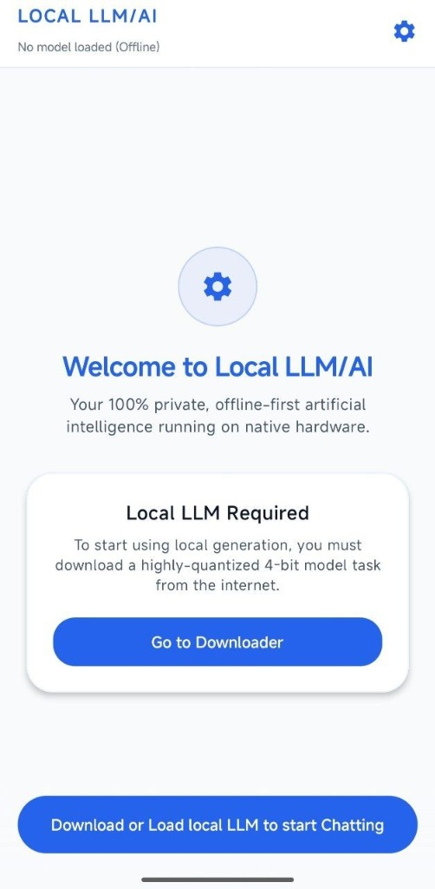
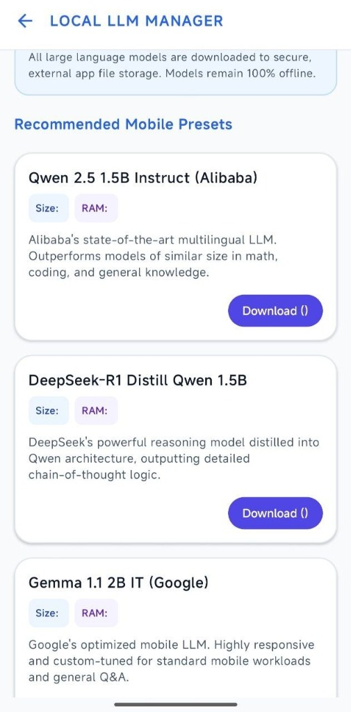

<div align="center">

# Local LLM/AI

### A premium, high-performance offline Android client for running Large Language Models (LLMs) on-device with multimodal OCR.

<br/>

[](https://github.com/PrinceBad/Local-LLM-AI/releases/latest)
[](LICENSE)
[](https://github.com/PrinceBad/Local-LLM-AI/releases)
[](#download)
<br/>

[**Download**](#download) • [**Features**](#features) • [**Supported Models**](#supported-models) • [**Innovations**](#recent-architecture-uiux--quality-of-life-innovations) • [**Screenshots**](#screenshots) • [**Credits**](#credits) • [**Disclaimer**](#disclaimer)

</div>

> [!WARNING]
> Local LLM/AI executes AI models entirely on your physical mobile device. Running on-device models is resource-intensive and requires a modern processor and sufficient RAM (4 GB+ minimum, 6 GB+ recommended). System stability, inference speeds, and output quality depend entirely on your hardware capability.
> Model weights (such as Qwen, SmolLM2, or Gemma) are not packaged inside the APK and can be downloaded in-app or sideloaded offline due to their file sizes (500 MB – 3.7 GB).

Additionally, this application executes all calculations offline. No internet connection is required after models are downloaded, and no conversational data ever leaves your device.

---

## What Is Local LLM/AI?

Local LLM/AI is a high-fidelity, modern Android client designed to provide a completely private, offline, and secure conversational AI experience. By integrating Google's optimized **AI Edge LiteRT-LM** engine, the app compiles and runs lightweight LLMs (like Qwen 3, SmolLM2, Qwen 2.5 Coder, and Gemma 4) natively on mobile hardware.

The app targets a 3-tier execution waterfall: Qualcomm Hexagon NPU (Snapdragon 8 Gen 1-4 / Elite via QNN HTP) → Vulkan GPU → targeted big-core CPU threads (XNNPACK) for responsive streaming generation.

The app wraps this powerful local engine in a premium, fluid Jetpack Compose (Material 3) user interface featuring offline OCR document parsing, video/file media integration, and background download handling.

---

## Supported Models

The app includes built-in presets for 10 highly-capable, lightweight models optimized for mobile execution:

| Model | Developer / Author | Parameters | Approx. Size | Min. RAM Requirement | Multimodal (Vision) | Role |
| :--- | :--- | :--- | :--- | :--- | :--- | :--- |
| **Qwen 3 0.6B (Pocket Turbo)** | Alibaba | 0.6B | ~498 MB | 2 GB+ | No | Ultra-Fast Pocket Turbo Floor Model |
| **Qwen 2.5 1.5B Instruct** | Alibaba | 1.5B | ~1.60 GB | 4 GB+ | No | Daily Multilingual Baseline (Q8) |
| **Qwen 3 1.7B (Dynamic INT4)** | Alibaba | 1.7B | ~977 MB | 4 GB+ | No | Sub-1GB Dynamic Compact Powerhouse |
| **Qwen 2.5 Coder 1.5B Instruct** | Alibaba | 1.5B | ~1.12 GB | 4 GB+ | No | Agile Code Intelligence & Scripting |
| **SmolLM2 1.7B Instruct** | Hugging Face | 1.7B | ~1.73 GB | 4 GB+ | No | State-of-the-Art Compact SLM (dynamic INT8) |
| **Google Gemma 4 E2B Instruct** | Google | 2.4B | ~2.59 GB | 6 GB+ | Yes | Budget Multimodal Vision & OCR |
| **Gemma 4 E2B Uncensored MAX** | PeppX / Google | 2.3B | ~2.55 GB | 6 GB+ | Yes | Compact Uncensored Multimodal (8K Ctx) |
| **SuperGemma 4 E4B Abliterated** | Jiunsong / typomonster | 4.0B | ~3.65 GB | 8 GB+ | Yes | Flagship Abliterated Multimodal with MTP |
| **Qwen 3 4B (Hybrid Reasoning)** | Alibaba | 4.0B | ~2.66 GB | 8 GB+ | No | Mid-Range High-Capacity Reasoning |
| **Google Gemma 4 E4B Instruct** | Google | 4.0B | ~3.66 GB | 8 GB+ | Yes | Flagship Multimodal Vision & OCR |

---

## Features

| Inference & Performance | Multimodal & OCR (100% Offline) |
| :--- | :--- |
| 3-Tier Execution Waterfall (Qualcomm Hexagon NPU → Vulkan GPU → Big-Core CPU) | Attach Images, Videos & Documents (PDF, Code, Text) |
| Universal Thinking Budget & Dynamic Toggle (`<think>`, `<|think|>`, `<thought>`) | Offline image OCR text extraction using Google ML Kit |
| Live Hardware Telemetry Pill (Time to First Token in ms, Tokens/Sec Decode Speed) | Offline page-by-page PDF rendering with auto bitmap recycling |
| Streaming word-by-word token generation with responsive Stop control | Video keyframe sampling via MediaMetadataRetriever for Vision LLMs |
| Adaptive Speculative Decoding & Multi-Core Big-Core Scheduling (up to 6 cores) | Auto fallback from GPU shader failures to CPU (XNNPACK) in AUTO mode |

| UI & Workflow | Privacy & Architecture |
| :--- | :--- |
| Windowed `LazyColumn` Settings architecture for 60/120 Hz butter-smooth scrolling | 100% on-device execution (no telemetry, ads, or data collection) |
| Interactive Collapsible Reasoning Accordion for CoT traces with streaming unclosed tags | Privacy-preserving Web Search Grounding with strict query isolation |
| Multi-Session Chat Manager with auto-titling, rename, and swipe deletion | Background download service with PARTIAL_WAKE_LOCK and HTTP 206 resume |
| Settings sliders for context window, temperature, top-k, top-p, and penalty | Hardware-backed AES-256 Keystore encryption with auto-recovery |
| Type-safe model catalog filtering chips (`entries`-backed: Turbo, Reasoning, Vision, Compact) | Full post-download SHA-256 verification and atomic file moves |

---

### Recent Architecture, UI/UX & Quality-of-Life Innovations

- **UI Smoothness & Lazy Windowing Overhaul**: Converted Settings into a windowed `LazyColumn` with modular item recycling, eliminating initial load stalls and delivering fluid 60/120 Hz scroll performance. Replaced dynamic object allocations during slider drags and chip switching with zero-allocation `entries` and memoized values.
- **Anchor-Aware Chat Auto-Scroll**: Fixed streaming text jitter by anchoring `scrollToItem` to the bottom of the active message bubble (`offset = 100,000`), completely eliminating jumping to offset 0 as long responses stream in.
- **Robust Upstream Model Matching & Seamless CPU Fallback**: Dual-indexed canonical preset names and raw Hugging Face download filenames (e.g. `qwen3_0_6b_mixed_int4.litertlm` ↔ `qwen3-0.6b.litertlm`). In `AUTO` mode, GPU shader compilation errors or timeouts on budget Vulkan drivers (e.g., Adreno 610) automatically step down to big-core CPU (XNNPACK) without crashing or requiring manual backend toggles.
- **Vision Executor Stabilization**: Added explicit CPU configuration for multimodal vision adapters (`visionBackend = Backend.CPU(threadCount)`), resolving upstream LiteRT-LM null vision executor errors on Gemma 4 multimodal turns.
- **Universal Reasoning Accordion & Multi-Tag Support**: Real-time collapsible reasoning accordion parsing `<think>...</think>`, `<|think|>...</|think|>`, and `<thought>...</thought>` with unclosed live streaming token support and clean historical thought-stripping.
- **Performance Tuning & Speculative Decoding**: Enabled adaptive speculative decoding (`SpeculativeDecodingMode.ADAPTIVE`), optimized CPU big-core allocation up to 6 cores, and reduced UI streaming throttle to 45ms.
- **Qualcomm Hexagon NPU & GPU Waterfall**: Multi-tier execution engine prioritizing NPU (Snapdragon 8 Gen 1–4 / Elite via Qualcomm QNN HTP) → Vulkan GPU → targeted big-core CPU threads. Automatically caches NPU subgraph incompatibility in persistent storage (`npu_backend_cache`) to prevent UI freezes.
- **Live Hardware Telemetry Pill**: Real-time performance badge beneath assistant messages displaying exact Time to First Token (TTFT in ms), token decode rate (tokens/sec), prompt token count, and total decode tokens.
- **Background Download Service with WakeLock**: Dedicated foreground download service (`dataSync`) protected by a reference-counted `PARTIAL_WAKE_LOCK` with a 2-hour safety timeout, ensuring Android Doze mode never suspends network sockets during multi-gigabyte downloads. Features seek-based HTTP 206 resumption with `RandomAccessFile`, live transfer speed, ETA, and post-download SHA-256 verification.
- **Privacy-Preserving Web Search Grounding**: Optional search grounding supporting DuckDuckGo, Wikipedia, Jina AI, Brave Search, and Serper. Strict query isolation ensures only the concise search query leaves the device; conversation history and system instructions remain 100% on-device.

---

## Screenshots

<div align="center">


&nbsp;&nbsp;&nbsp;&nbsp;


</div>

---

## Download

Grab the latest compiled APKs from the [GitHub releases page](https://github.com/PrinceBad/Local-LLM-AI/releases/latest).

The debug / release APK is optimized for mobile hardware using on-device NPU, GPU (Vulkan), or multi-threaded CPU.

---

## Build

To compile the application yourself, ensure you have Java 17 and Android SDK set up. Set your JDK path and run the compilation:

### Build Debug APK
```powershell
$env:JAVA_HOME = "C:\path\to\your\jdk-17"
./gradlew assembleDebug
```

### Build Release APK
```powershell
$env:JAVA_HOME = "C:\path\to\your\jdk-17"
./gradlew assembleRelease
```

---

## Credits

Local LLM/AI is built on top of state-of-the-art on-device intelligence libraries and modern Android components.

Special thanks to:

- [Google AI Edge LiteRT (LiteRT-LM)](https://github.com/google-ai-edge/litert-lm)
- [Google ML Kit Text Recognition](https://developers.google.com/ml-kit/vision/text-recognition)
- [Jetpack Compose & Material 3](https://developer.android.com/compose)
- [Coil Image Loading Library](https://github.com/coil-kt/coil)
- [OkHttp](https://github.com/square/okhttp)
- [Kotlin Coroutines Flow](https://github.com/Kotlin/kotlinx.coroutines)

---

## License

Local LLM/AI is licensed under the MIT License. See [LICENSE](LICENSE) for details.

---

## Disclaimer

Local LLM/AI is an independent, unofficial project. It is not affiliated with, funded, authorized, endorsed by, or associated with Google LLC, MediaPipe, Gemma, or any of their affiliates.

All trademarks, service marks, catalogs, artwork, metadata, and model weights remain the property of their respective owners. Users are responsible for procuring and loading model files in compliance with the respective model's terms of use, license agreements, and regional requirements.
